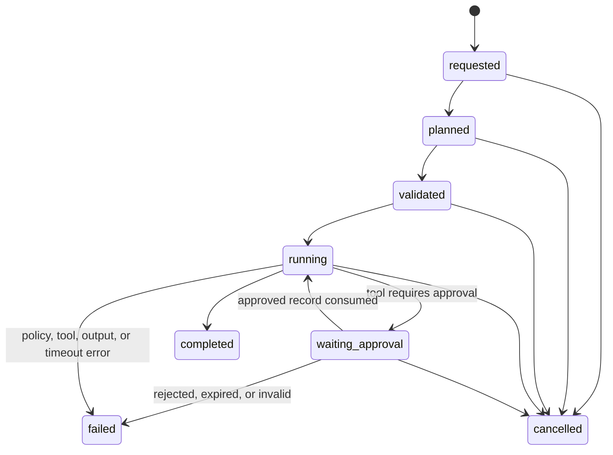

# Alpha agent runtime

## Contract

The runtime accepts a typed plan with at most five calls. The server snapshots and canonicalizes the plan before execution, checks each call against the registered tool schema and the authenticated identity, and checks again immediately before dispatch. Tool handlers are registered by trusted startup code; plans cannot import modules or choose Python callables. Outputs are JSON-validated and limited by each tool's row and byte limits.

Tools declare one side-effect class: `read`, `draft`, `write`, or `external`. A tool marked as requiring approval pauses before dispatch. Write and external tools must require approval at registration. Approval decisions require an active identity with an allowed role; by default an `admin` in the same workspace must approve, and the requester cannot approve their own request. An approval is bound to its run, call, plan hash, user, and workspace, expires, and is consumed once immediately before execution. Callers cannot pass approval IDs or boolean approval callbacks to the executor.

New requests that may be retried should provide an idempotency key. It is unique per authenticated user and workspace. Each registered call also receives a stable step idempotency key in `ToolCallContext`; side-effecting handlers should pass that key to their own persistence layer. Automatic retries are limited to read tools and one retry. SQLite state claims and per-process run locks prevent concurrent execution of the same run; a process crash after an external side effect still requires the handler's idempotency support.

The public trace read methods require an `AgentIdentity` and enforce workspace scope. A user can access their own runs; configured admins can access runs in their own workspace. API routes must obtain this identity from the signed server session, never from request JSON, query parameters, or custom identity headers. The shared session codec is in `alpha_core/auth.py`; the Knowledge Assistant resolves the cookie subject back to its active user row in `current_user`.

## State machine



SQLite transition checks reject illegal changes. Steps use the same states and are claimed with a compare-and-set update before a handler runs. Timeouts are recorded as the safe error code `TIMEOUT`; exceptions and stack traces are not stored in run results.

## Approval flow

```mermaid
sequenceDiagram
  participant User
  participant Runtime
  participant Store as SQLite approval store
  participant Approver
  participant Tool
  User->>Runtime: submit typed plan
  Runtime->>Store: persist run and exact plan hash
  Runtime->>Store: request approval for run + call + plan hash
  Runtime-->>User: waiting_approval + approval ID
  Approver->>Store: approve or reject using session identity
  Store-->>Approver: decision with approver ID and timestamp
  User->>Runtime: resume using run ID only
  Runtime->>Store: load saved plan and consume matching approval once
  Runtime->>Tool: re-check identity, scope, schema, and policy; dispatch
```

The store records approval ID, run ID, call ID, plan hash, requester and approver IDs, user/workspace scope, status, creation/expiry/decision/consumption times, and a bounded reason. Pending approvals are workspace-scoped. Expired, rejected, replayed, wrong-plan, wrong-user, or wrong-workspace approvals fail closed.

## Trace safety and retention

Trace fields are JSON-only. Sensitive keys (`password`, `token`, `secret`, `api_key`, `authorization`, and `cookie`) are redacted in stored arguments/results. Email redaction can be enabled with `TraceStore(redact_email=True)`. Plans containing a field configured for redaction are rejected before persistence because the exact saved plan is needed to resume. String fields, field counts, nesting depth, plan size, per-run bytes, and tool output are bounded. Every run and step shares a correlation ID. `RETENTION_DAYS` defaults to 30; call `TraceStore.purge_expired()` periodically from application maintenance to remove expired run/approval records.

The default trace store is in-memory for tests. A server can supply an SQLite path for process-restart resume and persisted approvals. SQLite contents are not encrypted at rest; only synthetic or otherwise non-sensitive tool arguments should be persisted. Production authentication, database encryption, distributed locking, and an operational retention scheduler are outside this local demo runtime.

## Threat model and limits

- Plans and tool arguments are untrusted. Policy and schemas run before dispatch, and the server identity is passed separately from plan data.
- Registry handlers and tool schemas are trusted application configuration. A compromised handler can still perform actions outside this runtime.
- Approval checks are enforced by the shared store. The UI/API must pass the authenticated session identity to approval methods and must protect state-changing cookie-authenticated routes against CSRF.
- SQLite compare-and-set plus local locks prevent duplicate dispatch while the process is alive. For side effects spanning a crash boundary, the handler must honor `ToolCallContext.idempotency_key` in its own transaction.
- The LLM is not part of this runtime's permission path. Deterministic plans work with `LLM_PROVIDER=none`; an optional planner may only produce typed plans for this executor to validate.

## Verification

Run `python -m pytest tests/test_agent_runtime.py tests/test_auth.py -q`, `ruff check alpha_core/agent alpha_core/auth.py`, and `mypy`. The adversarial tests cover approval spoofing/replay/expiry, role and workspace denial, plan and registry mutation, duplicate requests, timeouts, cancellation, limits, redaction, retention, illegal transitions, and LLM-off execution.
