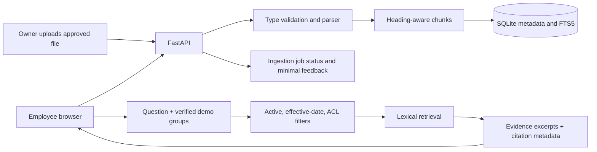

# Architecture and workflow

Ingestion is synchronous in this first local version. Each job records completion or `NEEDS_REVIEW`. A source update creates a new document version and deactivates prior versions after extraction succeeds. Retirement removes chunks from the search index while retaining metadata for audit. On questions, group filtering is applied before citations are built. The current deployment uses a request header as a demo principal; an actual deployment must validate identity server-side.
