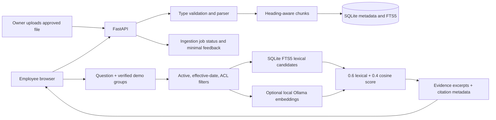

# Architecture and workflow

Ingestion is synchronous in this first local version. Each job records completion or `NEEDS_REVIEW`. A source update creates a new document version and deactivates prior versions after extraction succeeds. Retirement removes chunks from the search index while retaining metadata for audit. On questions, server-resolved group, active-status, and effective-date filters are applied in SQL before chunks are returned for scoring. Retrieval uses SQLite FTS5; when the optional local Ollama embedding model is available, its cosine score is fused with the normalized lexical rank as `0.6 * lexical + 0.4 * cosine`. Any embedding failure falls back to lexical retrieval. The answer composer is optional and receives only the already-filtered excerpts; deterministic evidence excerpts are the default.

The Alpha shell mounts 13 ASGI sub-applications under stable `/tools/<slug>/` prefixes. `PrefixApiPaths` is middleware for the existing stand-alone HTML pages: it rewrites root-relative `href` paths and `/api/` fetch paths to the sub-application prefix, allowing the legacy pages to continue working without changing their routes or rewriting the mounts.
